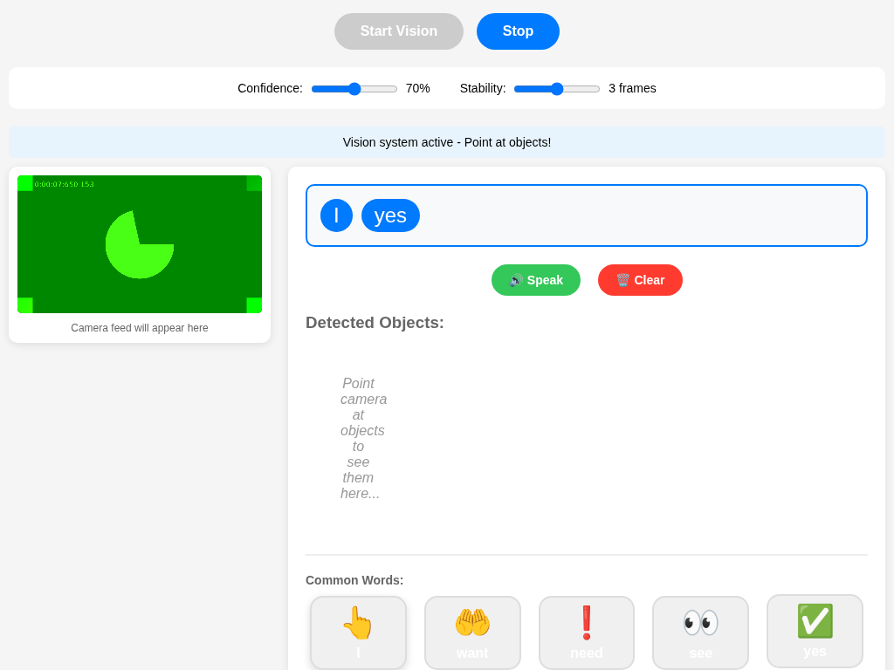
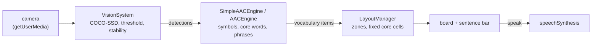

# VisionVocabularyAAC

[](https://github.com/elijahsylar/vision-vocabulary-aac/actions/workflows/ci.yml)

A browser prototype of an AAC (augmentative and alternative communication) board that builds part of its vocabulary from what the camera sees. Point a tablet at a cup and a "cup" button appears next to a fixed set of core words; tap buttons to build a sentence and have it spoken. The idea it explores: static AAC boards need someone to anticipate and pre-program every word, so vocabulary for a new place or object is often missing exactly when it is needed.



## What is built

- **On-device object detection**: TensorFlow.js with the COCO-SSD model (80 object classes) runs in the browser; no image leaves the device. A confidence threshold and a "stability" setting (an object must be seen in N consecutive frames) keep buttons from flickering.
- **Symbol mapping**: detected classes map to Unicode emoji symbols with a text label; unknown classes fall back to a question mark. Custom words can be added.
- **Core words**: a small fixed set of high-frequency words (pronouns, verbs such as want, need, go, help, descriptors such as more, stop, all done, social words and question words), written for this project and paired with emoji.
- **Phrase templates** (`AACEngine`): each detected object gets request and comment phrases ("Can I have some cup?", "I like cup") grouped by object category.
- **Grid layout** (`LayoutManager`): core words occupy fixed cells in the top rows so their positions never move (AAC users rely on motor memory); newly detected objects fill the rows below, preferring reachable cells. Positions are remembered across re-layouts.
- **Sentence bar and speech**: selected words form a sentence that the browser's speech synthesis reads aloud.

## Architecture



The demo pages (`test-simple-words.html`, `test-integrated.html`, `test-vision.html`) are self-contained: they load TensorFlow.js and COCO-SSD from a CDN and inline the classes, so they run from any static server. `src/core/` holds the same logic as ES modules, which the tests exercise. `docs/ARCHITECTURE.md` is the design document, including the parts that are not built.

## Stack

Vanilla JavaScript (ES modules), TensorFlow.js, COCO-SSD, Web Speech API, Vite for local serving, `node:test`.

## Running locally

Requirements: Node.js 20 or newer and a browser with a camera.

```bash
git clone https://github.com/elijahsylar/vision-vocabulary-aac.git
cd vision-vocabulary-aac
npm install
npm run dev
```

Open the URL Vite prints and go to `/test-simple-words.html`, then press **Start Vision** and allow camera access. Browsers only allow the camera on `localhost` or over HTTPS, so testing from a tablet on the same network needs an HTTPS setup (for example Vite's `--https` option with a local certificate).

### Tests

```bash
npm test
```

15 tests cover detection-to-button mapping, core-word ordering and the on/off option, symbol lookup and custom words, phrase generation, and the layout: every zone fits in the grid, core words stay in the top rows, no cell is used twice, core words keep their cells when the detected objects change, the fill metrics, and which detections count as stable across frames.

Writing them found three layout bugs that are fixed here: the "new objects" zone pointed past the bottom of the default 4-row grid (so detected objects were never placed), core words were not flagged as core, and moves were never recorded because the old position was overwritten before it was read. A config option (`includeCommonWords: false`) also could never take effect.

## Project status

Prototype, paused. Not a clinical tool and not tested with AAC users. Possible next steps are listed in `docs/ARCHITECTURE.md`: context-aware vocabulary, switch scanning, and integration with a professional symbol set.

## License

MIT. See [LICENSE](LICENSE). TensorFlow.js and the COCO-SSD model are Apache 2.0 and are loaded from their published packages, not redistributed here. Symbols are Unicode emoji rendered by the user's system font.
